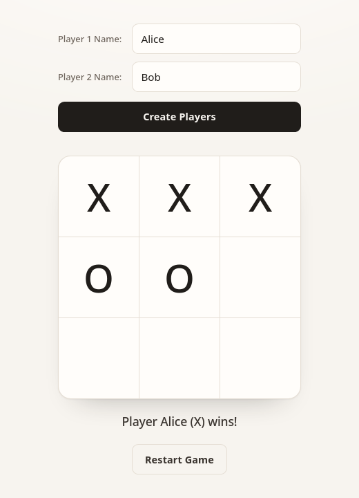

# Tic-Tac-Toe

A minimal two-player tic-tac-toe game built with vanilla HTML, CSS, and JavaScript.



## Features

- Local two-player game with custom names
- Win, tie, and restart handling
- Responsive layout with automatic light and dark themes

## Run

No build step or dependencies. Open `index.html` in your browser, or serve the folder:

```sh
python3 -m http.server 8000
```

Then visit <http://localhost:8000>.
